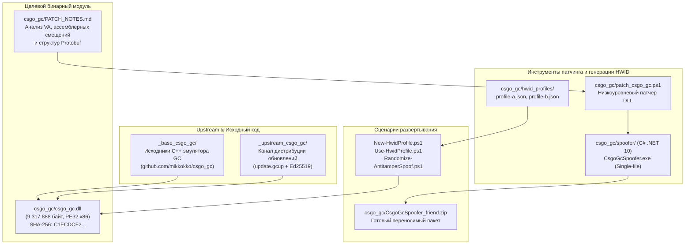

# Карта проекта CS:GO GC & HWID Spoofer

## 1. Общий обзор и назначение

Проект представляет собой комплексное инженерное решение для среды **CS:GO Legacy**, решающее две взаимосвязанные задачи:
1. **Эмуляция Game Coordinator (GC)** — локальная реализация серверного протокола Valve для управления инвентарём, скинами, открытием кейсов и P2P-лобби без постоянного подключения к официальным серверам.
2. **Спуфинг аппаратной телеметрии и обход детектора целостности (Anti-Tamper / HWID Spoofing)** — реверс-инжиниринг и низкоуровневая бинарная модификация библиотеки [csgo_gc.dll](file:///d:/Все%20бэкапы%20проектов%20с%20диска%20C/yaneebu/csgo_gc/csgo_gc.dll) с целью подмены собираемых идентификаторов (`volser`, `netmac`, `MachineGuid`, `SMBIOS`, аппаратные хеши) и формирования валидного синтетического отчёта (Protobuf сообщение 9205).

---

## 2. Архитектурная диаграмма связей



---

## 3. Каталог структуры проекта

```
yaneebu/
├── PROJECT_MAP.md                    # Настоящая карта проекта
├── .build-cache/                     # Локальный кэш сборки .NET и NuGet
│   ├── dotnet-home/
│   └── nuget/
├── _base_csgo_gc/                    # Исходный код базового проекта mikkokko/csgo_gc (C++17)
│   ├── CMakeLists.txt
│   ├── vcpkg.json
│   ├── csgo_gc/                      # Ядро эмулятора GC
│   │   ├── gc_client.cpp / .h        # Клиентский обработчик сообщений GC
│   │   ├── gc_server.cpp / .h        # Серверная логика координатора
│   │   ├── gc_shared.cpp / .h        # Диспетчеризация пакетов (включая сообщение 9205)
│   │   ├── inventory.cpp / .h        # Управление инвентарем и экипировкой
│   │   ├── item_schema.cpp / .h      # Парсинг схемы предметов CS:GO
│   │   ├── case_opening.cpp / .h     # Открытие кейсов и выпадение лута
│   │   ├── steam_hook.cpp / .h       # Перехват интерфейсов Steam API
│   │   └── platform_windows.cpp      # Специфичный для Windows код платформы
│   ├── launcher/                     # Кастомный загрузчик игры
│   │   ├── launcher_win.cpp
│   │   └── launcher_unix.cpp
│   ├── protobufs/                    # Определения сообщений Google Protobuf
│   │   └── cstrike15_gcmessages.proto# Схема CMsgGCCStrike15_v2_ClientReportValidation
│   └── examples/                     # Конфигурационные файлы (config.txt, inventory.txt)
├── _upstream_csgo_gc/                # Репозиторий дистрибуции обновлений SMorganYu/csgo_gc_public
│   ├── README.md                     # Инструкция по ручной установке апдейтов
│   └── updates/win32/                # Бандлы обновлений
│       ├── manifest.txt              # Хэши компонентов (версия 0.7.7.2.25)
│       ├── update.gcup               # Пакет бинарников обновления
│       ├── update.gcup.sig           # Подпись Ed25519
│       └── version.txt
└── csgo_gc/                          # Рабочее пространство модификации и спуфинга
    ├── PATCH_NOTES.md                # Технический отчёт по реверсу и бинарным смещениям
    ├── ИНСТРУКЦИЯ.txt                # Руководство для конечного пользователя
    ├── csgo_gc.dll                   # Активный рабочий бинарник DLL
    ├── csgo_gc.patched.dll           # Сгенерированный патченный бинарник
    ├── csgo_gc.synthetic.dll         # DLL со встроенным синтетическим отчётом
    ├── csgo_gc_27015.env             # Учетные данные выделенного сервера GC
    ├── user_stats_895744402.txt      # Локальный дамп статистики игрока
    ├── patch_csgo_gc.ps1             # Базовый генератор/патчер на PowerShell
    ├── New-HwidProfile.ps1           # Скрипт создания нового профиля оборудования
    ├── Use-HwidProfile.ps1           # Скрипт применения профиля оборудования
    ├── Randomize-AntitamperSpoof.ps1 # Скрипт генерации эфемерного HWID
    ├── CsgoGcSpoofer.exe             # Готовый скомпилированный автономный спуфер (x64)
    ├── CsgoGcSpoofer_friend.zip      # Пакет для переноса на другой ПК
    ├── hwid_profiles/                # Хранилище именованных профилей железа (JSON)
    │   ├── profile-a.json
    │   └── profile-b.json
    └── spoofer/                      # Исходный код спуфера на C#
        ├── CsgoGcSpoofer.csproj      # Конфигурация проекта .NET 10 (Single-File, Trimmed)
        ├── Program.cs                # Реализация инъектора, генератора энтропии и swap-механизма
        └── README.md
```

---

## 4. Детали реверс-инжиниринга и бинарного патчинга

### Характеристики целевого бинарника
* **Файл:** `csgo_gc.dll`
* **Архитектура:** PE32 (x86 32-bit)
* **Размер:** `9 317 888` байт
* **Контрольная сумма SHA-256:** `C1ECDCF26B48244C14EDFFE146402E1FA409DBFEC2A17CA4C4956514764EC3A6`

### Точки бинарной модификации в `csgo_gc.dll`

| Адрес (VA) | Файловое смещение | Исходные байты | Назначение и внедряемый код |
| :--- | :--- | :--- | :--- |
| `0x1005A810` | `0x59C10` | `55 8B EC 6A FE` | Точка входа в `AntiTamper::FillReport`. В synthetic-режиме заменяется на `jmp 0x10002DE3` (прыжок в кодовую пещеру в обход проверок). |
| `0x1005A889` | `0x59C89` | `C7 45 FC FE FF FF FF` | Эпилог `FillReport`. В sanitizer-режиме перенаправляется в пещеру для очистки полей аномалий перед возвратом. |
| `0x10002DE3` | `0x21E3` | `CC CC CC ...` | Кодовая пещера (Code Cave). Внедряется ассемблерный шеллкод: вызов `ClientReportValidation::Clear`, проставление PID через IAT, `osversion=10`, `clientreportversion=3`, запись 256-битного синтетического отпечатка в `diagnostic2..5`. |
| — | `0x20EB94` | `FF B5 7C FE FF FF` | Инструкция передачи `volser` (серийный номер диска). Заменяется на `push <imm32>; nop`. |
| — | `0x2120B7..0x2120D3` | `0F B6 46 xx ...` | 6 точек подстановки байт MAC-адреса (`netmac`). Заменяются на непосредственные значения (`mov al, imm8` / `push imm32`). |

### Схема Protobuf-сообщения `9205` (`CMsgGCCStrike15_v2_ClientReportValidation`)
Генерируемый синтетический отчёт выставляет следующие валидные поля:
* `file_report` (поле 1): пустая строка с установленным флагом присутствия (has-bit).
* `total_files`, `internal_error`, `count_pending`, `count_completed`, `status_id`: строго `0`.
* `process_id` (поле 8): реальный ID текущего процесса через API `GetCurrentProcessId`.
* `osversion` (поле 9): `10`.
* `clientreportversion` (поле 10): `3`.
* `diagnostic2`, `diagnostic3`, `diagnostic4`, `diagnostic5` (поля 13, 14, 18, 19): 256-битный аппаратный хэш.
* `report_count` (поле 16): `1`.

---

## 5. Сценарии использования и команды

### Автономная утилита (`CsgoGcSpoofer.exe`)
* **Автоматический запуск (без параметров):** создает чистую копию `csgo_gc.clean.dll`, генерирует новый случайный аппаратный профиль и активирует модифицированную `csgo_gc.dll`.
* **Только генерация:**
  ```cmd
  CsgoGcSpoofer.exe --generate-only
  ```
* **Восстановление оригинальной библиотеки:**
  ```cmd
  CsgoGcSpoofer.exe --restore
  ```

### Скрипты PowerShell (`csgo_gc/`)
* **Создание именованного профиля:**
  ```powershell
  .\New-HwidProfile.ps1 -Name profile-a
  ```
* **Применение именованного профиля:**
  ```powershell
  .\Use-HwidProfile.ps1 -Name profile-a -SyntheticReport -Activate -Force
  ```
* **Генерация одноразового спуф-профиля:**
  ```powershell
  .\Randomize-AntitamperSpoof.ps1 -Activate
  ```
